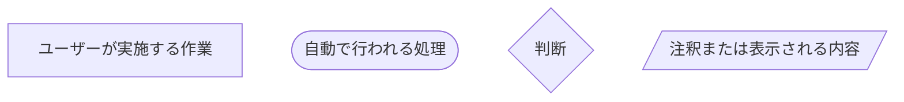
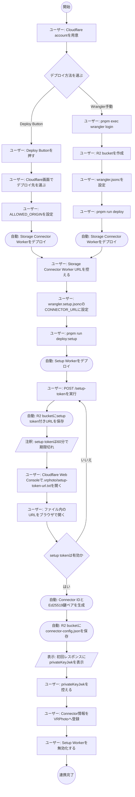

# インストール・セットアップ手順

この文書では、VRPhoto Storage Connector を Cloudflare へデプロイし、写真管理サイトから利用できる状態にするまでの手順を説明します。

この文書内で `{...}` と書かれている値はサンプルです。公開環境では必ず実際の値へ置き換えてください。

## この文書の読み方

- 全体の流れを確認する場合は「1. 概要」と「2. セットアップフロー」を先に読んでください。
- これから作業する場合は「3. 事前準備」から進めてください。
- デプロイ方法は「4. デプロイ方法」で、Deploy ButtonまたはWrangler手動デプロイのどちらかを選んでください。
- 初期化とVRPhoto登録は「5. 初期化とVRPhoto登録」を参照してください。
- 初期化後のSetup Worker運用、連携解除、失敗時の対応は「6. 運用」と「7. トラブル対応」を参照してください。

## 1. 概要

このリポジトリは、用途の違う2つの Cloudflare Workers を提供します。

| Worker | 設定ファイル | 役割 |
| --- | --- | --- |
| Storage Connector Worker | `wrangler.jsonc` | 写真管理サイトからの署名付きリクエストを検証し、R2 bucket の写真ファイルを保存、取得、削除、一覧取得します。 |
| Setup Worker | `wrangler.setup.jsonc` | 初期セットアップだけを受け付け、Connector ID と Ed25519 鍵ペアを生成します。生成した公開鍵はR2に保存し、秘密鍵は初回レスポンスでだけ返します。 |

## 2. セットアップフロー

セットアップは、Deploy Buttonで進める場合とWranglerで手動デプロイする場合があります。どちらの場合も、Storage Connector Worker と Setup Worker をデプロイしたあと、R2 bucket内に作成されたsetup token付きURLをCloudflare Web Consoleで確認して進めます。

### 2.1 図形の凡例



### 2.2 フロー



`setup token` は60分で期限切れになります。期限切れやURLのコピペミスなどで失敗が疑われる場合は、もう一度 `POST /setup-token` を実行して新しいURLを作成してください。

## 3. 事前準備

### 3.1 必要なもの

- Node.js
- pnpm
- Cloudflare account
- Cloudflare にログインできるブラウザ
- このリポジトリのソースコード

Cloudflare にデプロイする場合は、Cloudflare dashboard でアカウントを作成して、メールアドレス認証を済ませてください。

公式手順:
https://developers.cloudflare.com/fundamentals/account/create-account/

### 3.2 ローカルで確認する

#### 3.2.1 依存パッケージを入れる

```bash
cd r2_connector
pnpm install
```

#### 3.2.2 TypeScript の型チェックをする

```bash
pnpm run check
```

#### 3.2.3 単体テストを実行する

```bash
pnpm run test
```

このテストでは、Connector が署名トークンを確認し、R2 への保存・取得・削除を正しく処理できるかを確認します。

#### 3.2.4 ローカルで起動する

Storage Connector を起動します。

```bash
pnpm run dev
```

起動後、表示された URL の `/health` にアクセスします。

```bash
curl http://localhost:8787/health
```

Setup Worker をローカルで起動する場合は、別のターミナルで次を実行します。

```bash
pnpm run dev:setup
```

## 4. デプロイ方法

### 4.1 Deploy Button でインストールする

Cloudflare Deploy Button を使うと、GitHub のリポジトリから Cloudflare へデプロイできます。

[](https://deploy.workers.cloudflare.com/?url=https%3A%2F%2Fgithub.com%2Fvrphoto-project%2Fr2_connector)

手順の概要:

1. ボタンを押す
2. Cloudflare account にログインする
3. 画面の指示に従ってデプロイ先を選ぶ
4. `ALLOWED_ORIGIN` に写真管理サイトの Origin を設定する
5. デプロイ後に Storage Connector Worker URL を控える
6. Setup Worker を `pnpm run deploy:setup` でデプロイする
7. Setup Worker の `CONNECTOR_URL` に Storage Connector Worker URL を設定する
8. Setup Worker の `POST /setup-token` を実行し、R2 bucket内にsetup token付きURLファイルを作成する
9. Cloudflare Web ConsoleでR2 bucket内の `.vrphoto/setup-token-url.txt` を確認し、ファイル内のURLを開く
10. 生成された値を写真管理サイトへ登録する

Deploy Button で入力が必要なのは `ALLOWED_ORIGIN` だけです。

`CONNECTOR_ID` と `VRPHOTO_PUBLIC_KEY_JWK` は Deploy Button では入力しません。未設定の場合は Setup Worker が setup token 確認後に自動生成します。

`SITE_PAIRING_ENDPOINT` も Deploy Button では入力しません。写真管理サイト側にペアリング受信用 API がある場合だけ、デプロイ後に Cloudflare Workers の Variables から追加してください。

### 4.2 Wrangler で手動デプロイする

#### 4.2.1 Wrangler で Cloudflare にログインする

```bash
pnpm exec wrangler login
```

ブラウザが開くので、Cloudflare にログインして許可します。

#### 4.2.2 R2 bucket を作る

このプロジェクトの `wrangler.jsonc` では、初期値として次の bucket 名を使います。

```text
vrphoto-storage-r2connector
```

作成コマンド:

```bash
pnpm exec wrangler r2 bucket create vrphoto-storage-r2connector
```

作成できたか確認します。

```bash
pnpm exec wrangler r2 bucket list
```

bucket 名を変えたい場合は、`wrangler.jsonc` と `wrangler.setup.jsonc` の `r2_buckets.bucket_name` も同じ名前に変更してください。

```jsonc
"r2_buckets": [
  {
    "binding": "PHOTOS",
    "bucket_name": "vrphoto-storage-r2connector"
  }
]
```

`binding` の `PHOTOS` は、コード内で `c.env.PHOTOS` として使われる名前です。特別な理由がなければ変更しないでください。

#### 4.2.3 Storage Connector の値を設定する

デプロイ前に、`wrangler.jsonc` の `vars` を確認します。

```jsonc
"vars": {
  "ALLOWED_ORIGIN": "https://{vrphoto.example.com}"
}
```

| 名前 | 必須 | 説明 |
| --- | --- | --- |
| `ALLOWED_ORIGIN` | 必須 | ブラウザから Connector へアクセスできる写真管理サイトの Origin です。例: `https://{vrphoto.example.com}` |

`ALLOWED_ORIGIN` は写真管理サイトの URL に合わせて変更してください。固定 ID や固定公開鍵を使う場合だけ、Cloudflare Workers の Variables で `CONNECTOR_ID` と `VRPHOTO_PUBLIC_KEY_JWK` を追加します。`POST /pair` のコールバック方式を使う場合だけ、`SITE_PAIRING_ENDPOINT` も Variables へ追加します。

#### 4.2.4 Storage Connector をデプロイする

```bash
pnpm run deploy
```

成功すると、Cloudflare Workers の URL が表示されます。

```text
https://vrphoto-storage-connector.{your-subdomain}.workers.dev
```

この URL が写真管理サイトから見た Connector URL です。

#### 4.2.5 Storage Connector を確認する

```bash
curl https://vrphoto-storage-connector.{your-subdomain}.workers.dev/health
```

`ok: true` が返れば、デプロイされた Worker は動いています。

#### 4.2.6 Setup Worker をデプロイする

`wrangler.setup.jsonc` の `CONNECTOR_URL` を、Storage Connector Worker の公開URLへ変更します。

```jsonc
"vars": {
  "CONNECTOR_URL": "https://vrphoto-storage-connector.{your-subdomain}.workers.dev"
}
```

Setup Worker は Storage Connector と同じ R2 bucket を `PHOTOS` binding で参照します。デプロイします。

```bash
pnpm run deploy:setup
```

## 5. 初期化とVRPhoto登録

### 5.1 Connector ID と署名鍵を自動生成する

`CONNECTOR_ID` と `VRPHOTO_PUBLIC_KEY_JWK` が空の場合は、Setup Worker のデプロイ後に `POST /setup-token` を実行します。

```bash
curl -X POST https://vrphoto-storage-connector-setup.{your-subdomain}.workers.dev/setup-token
```

次のような JSON が返ります。

```json
{
  "created": true,
  "tokenFileKey": ".vrphoto/setup-token-url.txt",
  "expiresAt": "2026-08-30T07:00:00.000Z"
}
```

Cloudflare Web Consoleで、R2 bucket `vrphoto-storage-r2connector` の `.vrphoto/setup-token-url.txt` を開きます。
ファイル内に次のようなsetup token付きURLが書かれています。このURLは60分で期限切れになります。

```text
https://vrphoto-storage-connector-setup.{your-subdomain}.workers.dev/setup?setupToken=...
```

このURLをブラウザで開くと、初回だけ次のような JSON が返ります。

```json
{
  "initialized": true,
  "connector": {
    "connectorId": "生成されたUUID",
    "connectorUrl": "https://vrphoto-storage-connector.{your-subdomain}.workers.dev",
    "apiVersion": "v1",
    "publicKeyJwk": "{\"kty\":\"OKP\",\"crv\":\"Ed25519\",\"x\":\"...\"}",
    "privateKeyJwk": {
      "kty": "OKP",
      "crv": "Ed25519",
      "x": "...",
      "d": "..."
    }
  }
}
```

`privateKeyJwk` はこの初回レスポンスでだけ返るため、写真管理サイト側へすぐ登録してください。

setup token付きURLを開かずに `/setup` を実行した場合は、次のように拒否されます。

```bash
curl https://vrphoto-storage-connector-setup.{your-subdomain}.workers.dev/setup
```

```json
{
  "error": "setup_token_required"
}
```

Connector は R2 bucket 内の `.vrphoto/connector-config.json` に `connectorId` と `publicKeyJwk` を保存します。`privateKeyJwk` は保存しません。

Setup Worker は setup token の検証用に `.vrphoto/setup-token.json` も保存します。このファイルにはsetup tokenそのものではなく、検証用hashを保存します。

2回目以降の `GET /setup` / `POST /setup` は `409` と `setup_already_completed` を返し、Connector情報や `privateKeyJwk` は返りません。

### 5.2 写真管理サイトへ登録する情報

デプロイ後、写真管理サイト側には少なくとも次の情報を登録します。

| 項目 | 例 |
| --- | --- |
| Connector ID | `vrphoto-main-r2` |
| Connector URL | `https://vrphoto-storage-connector.{your-subdomain}.workers.dev` |
| R2 bucket name | `vrphoto-storage-r2connector` |
| R2 binding name | `PHOTOS` |
| 署名用 private key JWK | setup token付きURLを開いた初回レスポンスで返る `privateKeyJwk` |

管理サイト側の環境変数名は実装側の仕様に合わせます。既存仕様では、次のような値を設定します。

```text
VRPHOTO_R2_CONNECTOR_ID
VRPHOTO_R2_CONNECTOR_URL
VRPHOTO_R2_CONNECTOR_ACCOUNT_ID
VRPHOTO_R2_CONNECTOR_BUCKET_NAME
VRPHOTO_R2_CONNECTOR_JURISDICTION
```

## 6. 運用

### 6.1 初期化後のSetup Worker運用

Setup Worker は初期セットアップ専用です。VRPhotoへの登録が完了し、Storage Connector Workerが通常利用できる状態になった後は、Setup Workerは通常の写真保存・取得には使いません。

初期化後は、Setup Workerを削除するのではなく、無効化する運用を推奨します。再セットアップや鍵の作り直しが必要になった場合に、同じ設定を使って戻しやすくするためです。

運用例:

- Setup Workerに割り当てたRouteやCustom Domainを外し、外部URLから呼べない状態にする。
- Cloudflare dashboardでSetup Workerの公開URLやルーティングを停止する。
- 再セットアップや鍵の作り直しが必要なときだけ、Setup Workerを再度有効化する。

Setup Workerを無効化しても、R2 bucket内の `.vrphoto/connector-config.json`、写真ファイル、Storage Connector Workerは削除されません。そのため、VRPhotoに登録済みのConnector情報と署名鍵が正しければ、通常利用はStorage Connector Workerだけで継続できます。

ただし、次の作業が必要な場合はSetup Workerを再度使います。

- setup token付きURLを作り直す。
- Connector ID と Ed25519 鍵ペアを作り直す。
- `privateKeyJwk` を保存し忘れたため、再セットアップする。

再セットアップする場合は、必要に応じてR2 bucket内の `.vrphoto/connector-config.json`、`.vrphoto/setup-token-url.txt`、`.vrphoto/setup-token.json` を削除してから、Setup Workerを再デプロイし、`POST /setup-token` からやり直してください。

Setup Worker自体の削除は、今後このR2 bucketで再セットアップしないことが明確な場合だけ検討してください。

### 6.2 VRPhotoとの連携を解除する

VRPhotoとの連携を解除する場合は、写真管理サイト側の登録情報と、必要に応じてR2 bucket内のConnector設定を削除します。

#### 6.2.1 写真管理サイト側の登録を削除する

写真管理サイト側で、このConnectorに紐づく登録情報を削除します。

削除対象の例:

```text
VRPHOTO_R2_CONNECTOR_ID
VRPHOTO_R2_CONNECTOR_URL
VRPHOTO_R2_CONNECTOR_ACCOUNT_ID
VRPHOTO_R2_CONNECTOR_BUCKET_NAME
VRPHOTO_R2_CONNECTOR_JURISDICTION
署名用 private key JWK
```

写真管理サイト側の管理画面や環境変数の形式は、写真管理サイト本体の実装に合わせてください。

#### 6.2.2 Connector側の設定を削除する

同じConnectorを今後使わない場合や、別の署名鍵で作り直したい場合は、Cloudflare Web ConsoleでR2 bucket内の次の設定ファイルを削除します。

```text
.vrphoto/connector-config.json
.vrphoto/setup-token-url.txt
.vrphoto/setup-token.json
```

`.vrphoto/connector-config.json` を削除すると、Storage Connector は署名検証に必要な Connector ID と公開鍵を読めなくなります。そのため、既存の写真管理サイトからの署名付きリクエストは失敗します。

#### 6.2.3 写真ファイルは必要な場合だけ削除する

連携解除だけであれば、R2 bucket内の写真ファイルを削除する必要はありません。

写真ファイルも完全に削除したい場合だけ、R2 bucket内の `VRPotos/` 配下のオブジェクトを削除してください。この操作は復元できないため、バックアップや移行が必要ないことを確認してから実行してください。

## 7. トラブル対応

### 7.1 セットアップに失敗した場合

setup token付きURLは60分で期限切れになります。60分を過ぎた場合や、URLのコピペミスなどでセットアップに失敗と思われる場合は、setup tokenを作り直してください。

#### 7.1.1 setup tokenを作り直す

Setup Worker の `POST /setup-token` を再実行します。

```bash
curl -X POST https://vrphoto-storage-connector-setup.{your-subdomain}.workers.dev/setup-token
```

有効なsetup tokenがまだ残っている場合は、新しいtokenは発行されず、既存の `.vrphoto/setup-token-url.txt` を参照するレスポンスが返ります。

```json
{
  "created": false,
  "tokenFileKey": ".vrphoto/setup-token-url.txt",
  "expiresAt": "2026-08-30T07:00:00.000Z"
}
```

この場合は、Cloudflare Web Consoleで既存の `.vrphoto/setup-token-url.txt` を開き、ファイル内のURLをもう一度確認してください。

60分経過後に `POST /setup-token` を再実行すると、R2 bucket内の `.vrphoto/setup-token-url.txt` が新しいURLで上書きされます。新しいURLを使って初期セットアップを進めてください。

古い setup token付きURLは使わないでください。新しいtokenが発行された場合は、検証用の `.vrphoto/setup-token.json` も新しい内容に更新されます。

#### 7.1.2 すでにセットアップ済みと表示される場合

次のようなレスポンスが返る場合は、Connector はすでに初期セットアップ済みです。

```json
{
  "error": "setup_already_completed"
}
```

この場合、R2 bucket内に `.vrphoto/connector-config.json` が存在します。`privateKeyJwk` は初回レスポンスでしか返らないため、写真管理サイト側へ登録済みか確認してください。

`privateKeyJwk` を保存し忘れた場合は、既存の `.vrphoto/connector-config.json` だけでは復元できません。再セットアップが必要です。

再セットアップする場合は、Cloudflare Web ConsoleでR2 bucket内の次の設定ファイルを削除してから、もう一度 `POST /setup-token` からやり直します。

```text
.vrphoto/connector-config.json
.vrphoto/setup-token-url.txt
.vrphoto/setup-token.json
```

この操作では写真ファイル自体は削除しません。ただし、削除後に新しい Connector ID と署名鍵が発行されるため、写真管理サイト側の登録情報も新しい値へ更新してください。
